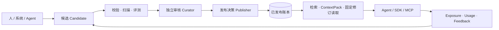

# Knowledge Ledger · 知谱

> 让每一条知识都有据可查。

知谱是一本给 AI Agent 用的**知识账本**：知识不是被"存"进来的文档，而是被"记"进来的账目。
每一次提交产生一条不可覆盖的修订，每一次发布绑定当下的策略水位，每一次引用都能回到它的出处。

**当前状态：** 可本地完整运行 · 单租户参考实现 · 实现自研协议 念（NIAN）v0.1

[快速开始](#快速开始) · [它解决什么问题](#它解决什么问题) · [界面](#界面) · [技术架构](#技术架构) ·
[开发与验证](#开发与验证) · [仓库结构](#仓库结构) · [生产边界](#生产边界)

---

## 它解决什么问题

企业把知识交给 Agent 时，真正的困难不是"检索不到"，而是**不敢用**：

- 这段话是谁写的？依据是什么？过期了吗？
- 模型引用的是三个月前那一版，还是昨天改过的那一版？
- 有人把错误口径改进去了，谁能拦住？改错了能不能只撤销不改写历史？
- 上线之后到底有没有被用上？用了之后结果是好是坏？

所以知谱把"知识消费前后的治理事实"也放进核心模型：

| 关注点 | 做法 |
| --- | --- |
| 来源可追溯 | 保留作者、生成活动、原始来源、证据与策略声明 |
| 版本不可覆盖 | Manifest 内容寻址（RFC 8785 JCS + SHA-256），修订只增不改 |
| 候选与发布隔离 | 贡献默认进入 Candidate，绕过审核进不了已发布账本 |
| 权限贯穿全链路 | 授权在召回、读取、组装上下文之前执行 |
| 质量不是一个分数 | 结构校验、安全扫描、评测、人工审核、时效、冲突各自独立成证据 |
| 效果形成证据 | Exposure → Usage → Feedback 可追踪，但反馈不直接改正文或排名 |
| 数据与代码分离 | 知识正文永远是不可信数据；可执行能力必须走独立制品与沙箱 |

一句话区别传统 RAG：

> RAG 解决"能不能找到"，知谱解决"敢不敢引用、引用之后能不能交代清楚"。

## 核心闭环



贡献成功不等于发布成功。Contributor、Evaluator、Curator、Publisher、Incident Responder、Eraser
是不同的职责；高风险状态变化必须绑定固定修订、证据、策略版本、幂等键与 ETag。

## 界面

控制台共 8 个工作面，围绕同一条工作流组织：

| 页面 | 你在上面做什么 |
| --- | --- |
| 工作台 | 一句判断 + 三个动作：今天该审谁、该补哪条证据、该发哪一版 |
| 知识库 | 带引用检索；每条结果都能展开来源、适用范围、质量证据与义务 |
| 贡献知识 | 三步提交候选：描述 → 边界与依据 → 确认；支持本地 Markdown 导入 |
| 审核中心 | 队列 + 详情对照：机器检查、证据引用、检查清单、通过/补证/拒绝 |
| 发布决策 | 把已审候选绑定当前策略水位发布；废弃、撤回、擦除分权执行 |
| 使用证据 | 发布 → 使用 → 反馈 → 合格 的漏斗，伤害信号单独进复审队列 |
| Agent 接入 | 协议能力、接入前自检、TypeScript / Python / cURL / MCP 示例 |
| 设置 | 节点、能力、身份与作用的边界 |

设计上刻意避开"又一个紫色 SaaS 后台"：纸白底、墨黑侧栏、朱砂强调色，修订号与状态用等宽字体，
信息密度高但每一条都可追溯——视觉语言本身就是产品主张。

## 技术架构

```
┌──────────────────────────── Browser ────────────────────────────┐
│  Vue 3 · Vite · TypeScript · Pinia · Element Plus · vue-router  │
└───────────────────────────────┬─────────────────────────────────┘
                                │ 同源 /nian/0.1 · /.well-known · /console
┌───────────────────────────────▼─────────────────────────────────┐
│  Core (Fastify): 鉴权 · 授权计划 · 治理状态机 · 查询与投影        │
└───────────────────────────────┬─────────────────────────────────┘
                                │ 单租户连接池 · 全表 FORCE RLS
┌───────────────────────────────▼─────────────────────────────────┐
│  PostgreSQL 17 + pgvector: 17 张租户事实表 · 不可变触发器 · Outbox │
└─────────────────────────────────────────────────────────────────┘
        ▲                                   ▲
        │ TypeScript / Python SDK           │ 独立 stdio MCP Adapter
   Agent / 服务端任务                   MCP Host（Claude Desktop 等）
```

- **前端**：Vue 3 组合式 API、Vite 8、TypeScript 严格模式、Pinia、Element Plus（只当零件用，
  主题被收回到自己的设计令牌里）。
- **后端**：Node 24 + Fastify 5、PostgreSQL 17 + pgvector、OIDC Remote JWKS、限流、安全头、OTLP。
- **协议**：本项目实现自研协议草案 **念（NIAN）v0.1**（Notarized Intelligence Asset Network），
  包含 OpenAPI 3.1、40 个 JSON Schema 与一致性样例。产品名与协议名是分开的。

### 技术栈

| 层级 | 技术 |
| --- | --- |
| Web | Vue 3、Vite 8、TypeScript、Pinia、Element Plus、vue-router |
| Core | Node.js 24、Fastify 5、PostgreSQL 17 + pgvector、OpenTelemetry |
| 协议 | NIAN v0.1、OpenAPI 3.1、JSON Schema、RFC 8785 JCS + SHA-256 |
| 集成 | TypeScript / Python SDK、MCP stdio Adapter |
| Worker | Python 3.13、jsonschema、RFC 8785 |

## 快速开始

只需要 Docker 与 Docker Compose：

```bash
git clone https://github.com/97Three/Knowledge-Ledger.git
cd Knowledge-Ledger
docker compose --profile app up --build
```

打开 `http://localhost:33005`。首次访问会启动五步引导，并通过真实 API 走完：

```text
连接节点 → 导入示例知识 → 独立审核与发布 → 带引用检索 → Agent 接入
```

写入一批演示数据（26 条知识，含已发布 / 待审核 / 待补证 / 待发布 / 已拒绝，以及引用与反馈）：

```bash
# 在仓库根目录，容器已经起来之后
pnpm --filter @nian/web seed:ledger-demo
```

脚本走的是真实 API（候选 → 审核 → 发布 → 引用 → 反馈），不是直接写库；重复执行会按标题跳过。

常用入口：

| 地址 | 用途 |
| --- | --- |
| `http://localhost:33005` | Web 控制台与统一 Origin |
| `http://localhost:38085` | Core 直连调试 |
| `http://localhost:38085/.well-known/nian` | 能力发现（Capability Discovery） |
| `http://localhost:38085/health/ready` | 就绪检查 |

端口冲突时：`NIAN_HOST_PORT=38086 NIAN_WEB_PORT=33006 docker compose --profile app up --build`。

### 宿主机开发

需要 Node.js 24、pnpm 11、Python 3.13+、uv、Docker Compose：

```bash
corepack enable
pnpm install
docker compose up -d postgres
cp .env.example .env
pnpm db:migrate
pnpm dev          # Core  :38085
pnpm dev:web      # 控制台 :33005（Vite 代理到 Core）
```

完整步骤与排障见[本地开发运行手册](docs/runbooks/local-development.md)。

## 开发与验证

```bash
pnpm check            # 类型、单元测试、协议契约、文档链接、SDK、Worker
pnpm build            # 全部生产构建
pnpm test:integration # PostgreSQL 事务、不可变量与完整成长闭环
NIAN_WEB_ORIGIN=http://localhost:33005 pnpm smoke:web
```

`pnpm check` 覆盖 Core 与 Web 单元测试、40 个公开 Schema、8 个协议样例、2 个 Profile、
JCS 黄金向量、Markdown 本地链接、TypeScript/Python SDK、MCP 类型、Python Worker。

## 仓库结构

```text
.
├── apps/
│   ├── web/               # Vue 3 控制台
│   ├── core/              # NIAN HTTP、授权、治理、事务与查询
│   └── mcp-server/        # 独立 MCP stdio Adapter
├── packages/
│   ├── sdk-ts/            # TypeScript SDK
│   └── sdk-python/        # Python SDK
├── workers/knowledge-worker/  # 无数据库权限的 Python Worker
├── specs/nian/v0.1/       # OpenAPI、JSON Schema、Profile、测试向量
├── contracts/internal/    # Core / Worker 版本化任务契约
├── infra/                 # Docker、PostgreSQL 迁移与验证脚本
├── docs/                  # 架构、协议、治理、产品、API 与运行手册
└── compose.yaml
```

## 文档

| 主题 | 文档 |
| --- | --- |
| 组件与数据边界 | [系统概览](docs/architecture/system-overview.md) |
| 协议语义 | [NIAN v0.1 草案](docs/protocols/nian-v0.1.md) |
| HTTP API | [快速参考](docs/reference/http-api.md) |
| 信任与发布 | [治理基线](docs/governance/trust-and-publication.md) |
| 当前完成度与缺口 | [实现状态](docs/architecture/implementation-status.md) |
| 本地开发 | [运行手册](docs/runbooks/local-development.md) |

## 生产边界

当前实现是**受控单租户试点**的技术基线，不是可以直接对外承诺的生产系统。扩大部署前至少还要完成：

1. 控制面 Principal → Tenant 映射、事务级动态 Tenant、外部 PDP 与完整策略谓词下推。
2. 加密对象存储、隔离上传、恶意文件扫描、解析沙箱与擦除证明。
3. 维护调度 / Owner SLA / Outbox relay 与停用演练。
4. 高可用观测、审计安全日志、备份恢复、密钥轮换与容量演练。
5. 语义 / 混合检索的授权下推、模型指纹与召回评测。
6. 生产 Web 会话、短期 token 刷新与高权限二次确认。

`NODE_ENV=production` 会拒绝 development 认证，不能通过配置绕过。详见
[试点 Go/No-Go 清单](docs/runbooks/production-pilot.md#0-go-no-go-检查)。

---

许可证、公共命名空间与一致性治理尚未最终确定。在完成这些决策前，不对外声称 NIAN 是公共标准，
也不声称本实现已满足通用生产合规。
